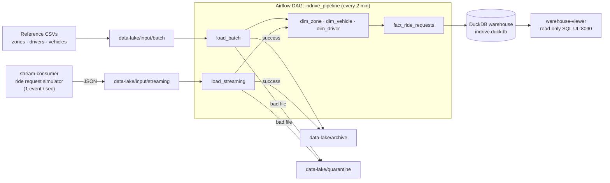
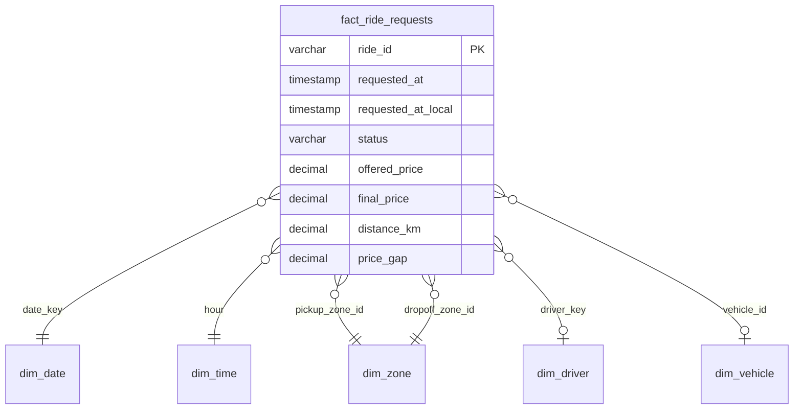

# inDrive Rides Data Pipeline

An end-to-end data engineering project that simulates the data platform behind a ride-hailing app like **inDrive**. A live stream of ride requests and a set of batch reference files are ingested into a data lake, loaded into a **DuckDB** warehouse, and modelled into a **Kimball star schema**, all orchestrated by **Apache Airflow** and running locally with **Docker Compose**.

The project focuses on the problems a real pipeline has to handle: idempotent loads, bad input, auditability, slowly changing dimensions and time zones.

---

## Architecture



| Service | Role |
|---|---|
| `warehouse-init` | Runs once at startup: builds every table from `warehouse/schema.sql`, then exits. Airflow only starts after it succeeds. |
| `stream-consumer` | Simulates ride requests and writes one JSON file per event into the data lake. |
| `airflow` | Runs the `indrive_pipeline` DAG: load raw data, update the dimensions, then build the fact table. |
| `warehouse-viewer` | A small read-only web UI to browse tables and run `SELECT` queries against the warehouse. |

The project keeps three concerns apart:

- **Schema** is created at build time (`warehouse/schema.sql`). The DAG never runs DDL.
- **Logic** lives in `scripts/load.py` and `scripts/transform/*.sql`.
- **Orchestration** lives in `dags/indrive_pipeline.py`, which only decides what runs, when, and in which order.

---

## The data

### Batch sources: reference data
Small CSV files describing what *exists*, which change rarely:

| File | Content |
|---|---|
| `zones.csv` | Casablanca neighbourhoods (Maarif, Ain Diab, Anfa, …) |
| `drivers.csv` | Driver profile: name, phone, city, rating, join date |
| `vehicles.csv` | Vehicle per driver: make, model, plate, category (`economy` / `comfort` / `xl`) |

### Streaming source: ride requests
Events describing what *happened*, one per ride request:

```json
{
  "ride_id": "ride_20261003154716_df8e7c76",
  "requested_at": "2026-10-03T15:47:16.950016",
  "pickup_zone_id": 3, "dropoff_zone_id": 5,
  "status": "completed",
  "offered_price": 14, "final_price": 16, "distance_km": 3.42,
  "driver_id": 2, "vehicle_id": 2
}
```

The simulator models inDrive's main feature: **the passenger names the price**. A driver either accepts the offer or counter-offers higher. Low offers are much more likely to end with `no_driver`. Each request ends as `completed`, `cancelled` or `no_driver`.

About 5% of events reference a zone or driver that doesn't exist, on purpose, so the pipeline's data quality rules have real bad data to catch.

---

## Data model



**Grain: one row per ride request**, not per completed ride. Unfulfilled demand is a key business metric, so this grain can answer questions like *"what share of requests never found a driver, and where?"* Revenue questions simply filter on `status = 'completed'`.

The warehouse is organised in layers:

| Layer | Tables | Behaviour |
|---|---|---|
| Audit | `load_audit` | One row for every file processed, with status, row count and error message |
| Raw | `raw_zones`, `raw_drivers`, `raw_vehicles`, `raw_ride_requests` | A faithful copy of each source, plus lineage columns (`source_file`, `loaded_at`) |
| Dimensions | `dim_date`, `dim_time`, `dim_zone`, `dim_vehicle`, `dim_driver` | Conformed, query-ready descriptions |
| Facts | `fact_ride_requests`, `fact_ride_requests_rejected` | Measurable events, plus the rows that failed validation |

### Three dimensions, three SCD strategies

Each dimension uses a different Slowly Changing Dimension strategy. The choice depends on how much history that attribute needs:

| Dimension | Strategy | Why |
|---|---|---|
| `dim_zone` | **Type 1**: overwrite | A renamed zone doesn't need old rides attributed to the old name. |
| `dim_vehicle` | **Type 3**: previous value column | `previous_vehicle_type` answers *"which cars were upgraded from economy to comfort?"* without keeping a full timeline. |
| `dim_driver` | **Type 2**: new row for each version | A driver's rating or city changes over time. Every ride links to the driver **as they were when the ride happened**, through `driver_key` and a `[valid_from, valid_to)` window. |

`dim_date` and `dim_time` are static calendars, generated once at build time. `dim_time` labels each hour with a part of the day and flags peak hours.

---

## Engineering decisions

**Idempotent loads.** Reference CSVs are upserted by natural key (`INSERT … ON CONFLICT DO UPDATE`), so loading an updated file changes rows instead of duplicating them. Ride events are append-only, and `ride_id` is the primary key with `ON CONFLICT DO NOTHING`, so loading the same file twice has no effect.

**Watermarking.** Each raw ride carries a `processed_at` column. The fact transform reads only rows where it is still `NULL`, then sets it for exactly those rows, all in one transaction. Re-running the DAG never adds the same ride to the fact table twice.

**Quarantine instead of crashing.** A malformed file is moved to `data-lake/quarantine/` and gets a `failed` row in `load_audit` with the error message. The DAG keeps running. Every file processed, good or bad, leaves exactly one audit row. A file is archived with a timestamp after it is processed, so the data lake's `input/` folder only ever holds new data.

**Row-level validation.** Each ride is checked against the dimensions before it enters the fact table: unknown status, zone, driver or vehicle, a date outside the calendar, or a completed ride with no driver or price. A ride that fails a check goes to `fact_ride_requests_rejected` with a readable `reason`. No row is silently dropped: every raw ride ends up in either the fact table or the rejected table.

**One clock for time zones.** Timestamps are stored in **UTC**, and the SCD Type 2 windows use the same clock. During development, Python's time zone database and DuckDB's disagreed on Casablanca's current UTC offset, which broke the driver history. The warehouse now does the conversion to Africa/Casablanca time itself, in one place, to derive `date_key`, `hour` and `requested_at_local`. Peak-hour analysis therefore reflects the time riders actually saw.

**Type safety at the boundary.** CSVs are read as text and cast by the target table's types during the insert. Automatic type detection would read the phone number `0661020304` as an integer and drop its leading zero.

**Safe concurrency with an embedded database.** DuckDB allows only one writer at a time. The DAG sets `max_active_runs=1` and retries tasks. The viewer opens a short read-only connection for each request. The simulator writes `*.json.tmp` and renames the file when it's complete, so the loader never reads a half-written event.

---

## Example questions the model answers

Share of requests that never found a driver, by pickup zone:
```sql
SELECT z.zone_name,
       count(*) AS requests,
       round(100.0 * count(*) FILTER (WHERE f.status = 'no_driver') / count(*), 1) AS pct_no_driver
FROM fact_ride_requests f JOIN dim_zone z ON z.zone_id = f.pickup_zone_id
GROUP BY 1 ORDER BY pct_no_driver DESC;
```

How often drivers counter-offer, and by how much:
```sql
SELECT round(100.0 * count(*) FILTER (WHERE price_gap > 0) / count(*), 1) AS pct_countered,
       round(avg(price_gap) FILTER (WHERE price_gap > 0), 2)            AS avg_counter_mad
FROM fact_ride_requests WHERE status = 'completed';
```

Demand by local hour of day:
```sql
SELECT t.hour, t.day_part, t.is_peak, count(*) AS requests
FROM fact_ride_requests f JOIN dim_time t ON t.hour = f.hour
GROUP BY ALL ORDER BY t.hour;
```

Rides attributed to each historical version of a driver (SCD Type 2):
```sql
SELECT d.driver_key, d.rating, d.valid_from, d.valid_to, count(*) AS rides
FROM fact_ride_requests f JOIN dim_driver d USING (driver_key)
WHERE f.driver_id = 1
GROUP BY ALL ORDER BY d.valid_from;
```

---

## Running it locally

Requires Docker with Compose v2, and free ports 8081 and 8090.

```bash
docker compose up -d --build
```

- **Airflow UI:** http://localhost:8081 (user `admin`; the password is in `docker compose exec airflow cat /opt/airflow/standalone_admin_password.txt`)
- **Warehouse viewer:** http://localhost:8090

The DAG runs every two minutes. `docker compose down` stops everything. The warehouse file and the data lake stay on disk, because every folder is bind-mounted.

---

## Project structure

```
├── consumer/            # ride request simulator (streaming source)
├── dags/                # Airflow DAG: orchestration only
├── data-lake/
│   ├── input/           # batch/ (CSVs) and streaming/ (JSON) landing zone
│   ├── archive/         # processed files, timestamped
│   └── quarantine/      # files that failed to load
├── scripts/
│   ├── load.py          # raw layer: upsert, append, audit, archive/quarantine
│   ├── run_sql.py       # generic SQL runner used by transform tasks
│   └── transform/       # one SQL file per dimension, plus the fact table
├── viewer/              # read-only warehouse web UI
├── warehouse/           # schema.sql + one-shot init service
├── airflow/             # Airflow image with duckdb + pandas baked in
└── docker-compose.yml
```

## Tech stack

Apache Airflow 2.9 · DuckDB 1.0 · Python 3.11 · SQL · Docker Compose
